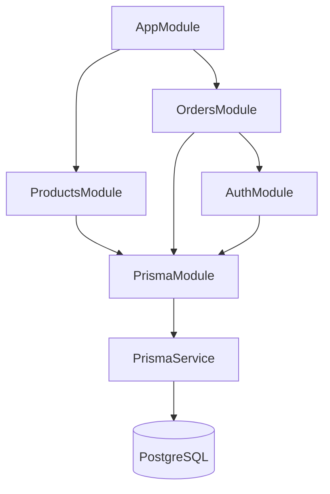
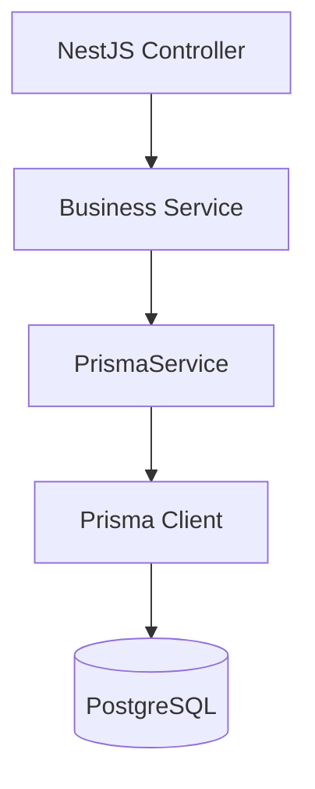
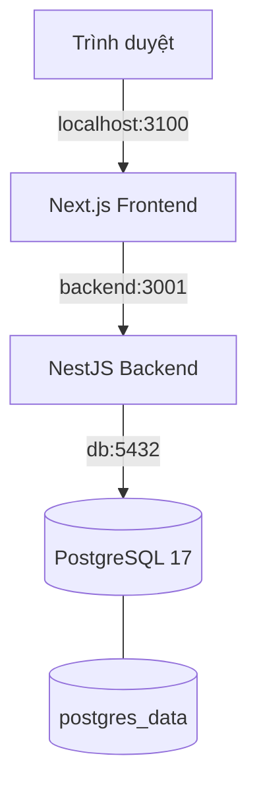

# BrewLite Assignment 2 — Kiến trúc hệ thống

**Task:** A2-ARCH — Task 3.1
**Phụ trách:** Thành viên D
**Reviewer dự kiến:** Thành viên E
**Trạng thái:** Draft — chờ review
**Ngày cập nhật:** 13/11/2026

## 1. Mục tiêu và phạm vi

Tài liệu mô tả kiến trúc tổng thể của hệ thống BrewLite Assignment 2, bao gồm cách tổ chức các thành phần, phân chia trách nhiệm, quan hệ phụ thuộc, chiến lược dữ liệu và các quyết định thiết kế.

Tài liệu được xây dựng dựa trên source của repository `BrewLite-Assignment2`, nhánh `main` tại commit `3be4a11`.

Phần kiến trúc Frontend/BFF/PWA kế thừa tài liệu `docs/architecture/frontend-bff-pwa.md` do thành viên A đóng góp. Phần Docker Compose và Product BFF đối chiếu với PR A2 #7 của thành viên E.

### 1.1. Công nghệ sử dụng

| Thành phần | Công nghệ                        |
| ---------- | -------------------------------- |
| Frontend   | Next.js, TypeScript              |
| Backend    | NestJS, TypeScript               |
| Database   | PostgreSQL 17                    |
| ORM        | Prisma 7.10.1                    |
| Container  | Docker, Docker Compose           |
| PWA        | Web App Manifest, Service Worker |

### 1.2. Kiến trúc phân lớp

BrewLite A2 được tổ chức thành bốn tầng logic chính:

1. **Presentation Layer:** Next.js và Client Components cung cấp giao diện sản phẩm, giỏ hàng, xác thực và đặt hàng.
2. **BFF Layer:** Next.js Route Handlers làm trung gian cho các yêu cầu cần xử lý phía server, bao gồm Auth, Orders và Product BFF.
3. **Business Layer:** NestJS Controllers, Services, Guards và DTO xử lý API, xác thực, kiểm tra dữ liệu và nghiệp vụ.
4. **Persistence Layer:** Prisma cung cấp khả năng truy cập PostgreSQL để lưu trữ dữ liệu bền vững.

Trong cấu hình Docker Compose local, trình duyệt truy cập Next.js tại `http://localhost:3100`. Frontend kết nối đến backend qua `http://backend:3001`, còn backend kết nối PostgreSQL qua `db:5432`.

### 1.3. Giới hạn xác nhận

Tài liệu kiến trúc ban đầu được xây dựng trên source Assignment 2 tại commit `3be4a11`. Phần cập nhật Checkout V2 được đối chiếu với `origin/main` tại commit `4c177bf`, sau khi PR #11 (`integration/a2-checkout-e2e`) được merge.

Checkout V2 bổ sung các trạng thái Order `PENDING`, `PAYMENT_FAILED`, `PAID`, `PREPARING`, `READY`, `COMPLETED` và `CANCELLED`; `MockPaymentService` hỗ trợ kết quả giả lập `SUCCEEDED` hoặc `FAILED` cho phương thức `WALLET` và `CARD`. Database được mở rộng với PaymentAttempt, StockReservation, LoyaltyEntry, Promotion và các trường quản lý tồn kho, điểm thưởng.

Bằng chứng QA Windows/Compose ngày 13/11/2026 ghi nhận Compose 8/8 và Browser 9/9, không có page error. Kết quả này thuộc lượt chạy local trên nhánh tích hợp, có thay đổi chưa commit tại thời điểm kiểm thử; không được xem là bằng chứng GitHub CI, triển khai HTTPS production hoặc nghiệm thu toàn bộ acceptance criteria.

Các mô tả trong tài liệu phân biệt rõ thành phần đã có trong source, kết quả kiểm thử được báo cáo và những nội dung chưa được xác minh. Không sử dụng kết quả Assignment 1 làm bằng chứng nghiệm thu Assignment 2.

## 2. Kiến trúc module Backend NestJS

### 2.1. Cấu trúc module

Backend BrewLite A2 được tổ chức theo các module nghiệp vụ và module hạ tầng, sử dụng cơ chế Dependency Injection của NestJS.

Sơ đồ mô tả các quan hệ import module được xác nhận từ source. Quan hệ giữa PrismaService và PostgreSQL thể hiện luồng truy cập dữ liệu, không phải quan hệ import module NestJS.

### 2.2. Trách nhiệm của từng module

| Module         | Trách nhiệm                                          | Thành phần                                |
| -------------- | ---------------------------------------------------- | ----------------------------------------- |
| AppModule      | Module gốc, tổ chức các module chính và health check | HealthController                          |
| ProductsModule | Cung cấp chức năng API sản phẩm                      | ProductsController, ProductsPrismaService |
| OrdersModule   | Cung cấp chức năng API đơn hàng                      | OrdersController, OrdersService           |
| AuthModule     | Cung cấp chức năng xác thực và bảo vệ API            | AuthController, AuthService, AuthGuard    |
| PrismaModule   | Cung cấp PrismaService cho các module khác           | PrismaService                             |

### 2.3. Quan hệ phụ thuộc

- `AppModule` import `ProductsModule` và `OrdersModule`.
- `ProductsModule` import `PrismaModule`.
- `OrdersModule` import `PrismaModule` và `AuthModule`.
- `AuthModule` import `PrismaModule`.
- `PrismaModule` export `PrismaService`.
- `AuthModule` export `AuthService` và `AuthGuard`.

`AuthModule` không được import trực tiếp trong `AppModule` tại phiên bản source đã khảo sát, mà được import thông qua `OrdersModule`.

### 2.4. Dependency Injection

NestJS sử dụng Dependency Injection để cung cấp các đối tượng phụ thuộc cho controller và service.

Ví dụ, `PrismaModule` đăng ký `PrismaService` trong `providers` và công khai thông qua `exports`. Module khác có thể import `PrismaModule` để sử dụng provider này.

Cách tổ chức này giúp:

- Tách trách nhiệm giữa controller, service và lớp truy cập dữ liệu.
- Hạn chế khởi tạo thủ công các dependency.
- Hỗ trợ thay thế dependency bằng mock trong unit test.
- Dễ mở rộng hoặc bảo trì các module nghiệp vụ.

### 2.5. Nguyên tắc phân lớp

- **Controller:** Tiếp nhận request và trả response.
- **Service:** Thực hiện logic nghiệp vụ.
- **Guard:** Kiểm tra điều kiện truy cập.
- **PrismaService:** Cung cấp khả năng truy cập cơ sở dữ liệu.

Đây là cách phân chia trách nhiệm ở mức kiến trúc. Chi tiết từng endpoint và luồng xử lý cần đối chiếu với implementation và test tương ứng.

### 2.6. Các thành phần hỗ trợ vận hành và Checkout V2

**Mock Payment**

Checkout V2 sử dụng `MockPaymentService` trong backend NestJS để giả lập kết quả thanh toán. Service đọc biến môi trường `MOCK_PAYMENT_OUTCOME`, mặc định là `SUCCEEDED` và chỉ chấp nhận hai giá trị `SUCCEEDED` hoặc `FAILED`.

Các phương thức thanh toán được hỗ trợ trong mock là `WALLET` và `CARD`. Đây là cơ chế giả lập phục vụ phát triển và kiểm thử, không phải tích hợp cổng thanh toán production.

**Logging**

Backend sử dụng cơ chế `Logger` của NestJS tại một số thành phần, bao gồm `ProductsPrismaService`, để ghi nhận lỗi trong quá trình xử lý dữ liệu.

Chưa xác nhận hệ thống có logging tập trung, correlation ID hoặc giải pháp giám sát production.

**Health Check**

`HealthController` cung cấp endpoint `GET /health`, trả về trạng thái `ok` và tên service `brewlite-api`.

Endpoint này kiểm tra khả năng phản hồi của tiến trình API, không thực hiện kiểm tra kết nối PostgreSQL. Vì vậy, đây là liveness check, chưa phải database readiness check.

**Configuration Management**

Backend sử dụng biến môi trường thông qua `process.env`, bao gồm `DATABASE_URL` và `MOCK_PAYMENT_OUTCOME`.

`PrismaService` yêu cầu `DATABASE_URL` để thiết lập kết nối PostgreSQL. `MockPaymentService` kiểm tra giá trị cấu hình mock payment khi khởi tạo.

Chưa xác nhận việc sử dụng `@nestjs/config` hoặc `ConfigModule` trong source đã khảo sát.

**Order Workflow**

Checkout V2 bổ sung cơ chế kiểm soát chuyển trạng thái Order. Những chuyển trạng thái không hợp lệ bị từ chối bằng `ConflictException` với mã lỗi `INVALID_ORDER_TRANSITION`.

Các thành phần nghiệp vụ liên quan bao gồm `MockPaymentService`, xử lý tồn kho và quản lý điểm thưởng. Chi tiết tính nhất quán dữ liệu và giao dịch được mô tả tại phần 3.

## 3. Kiến trúc dữ liệu, Migration và Mock

### 3.1. Kiến trúc dữ liệu

BrewLite A2 sử dụng PostgreSQL làm hệ quản trị cơ sở dữ liệu quan hệ và Prisma làm lớp truy cập dữ liệu.

Luồng truy cập dữ liệu tổng quát:

Đây là sơ đồ kiến trúc logic. Một số module có thể sử dụng service truy cập dữ liệu chuyên biệt, ví dụ `ProductsPrismaService`.

### 3.2. Mô hình dữ liệu

Prisma schema của BrewLite Assignment 2 được mở rộng từ 9 model của Sprint 2 lên 13 model sau Checkout V2.

| Nhóm | Model | Vai trò |
| --- | --- | --- |
| Catalog | Product | Sản phẩm, tồn kho và phiên bản tồn kho |
| Catalog | Topping | Thông tin topping |
| Catalog | ProductTopping | Quan hệ sản phẩm và topping |
| Authentication | User | Tài khoản và điểm thưởng |
| Authentication | AuthSession | Phiên đăng nhập |
| Orders | Order | Đơn hàng, trạng thái và thông tin checkout |
| Orders | OrderItem | Chi tiết món trong đơn |
| Orders | OrderItemTopping | Topping của từng món |
| Orders | OrderRequest | Ghi nhận yêu cầu tạo đơn và idempotency |
| Checkout | PaymentAttempt | Ghi nhận các lần thanh toán |
| Checkout | StockReservation | Quản lý giữ, tiêu thụ, giải phóng và hoàn hàng |
| Loyalty | LoyaltyEntry | Ghi nhận cộng điểm và thu hồi điểm |
| Promotion | Promotion | Cấu hình chương trình khuyến mãi |

**Trạng thái đơn hàng**

`OrderStatus` gồm `PENDING`, `PAYMENT_FAILED`, `PAID`, `PREPARING`, `READY`, `COMPLETED` và `CANCELLED`.

`OrderRequestState` gồm `SUCCEEDED` và `REJECTED`.

**Thanh toán**

`PaymentMethod` gồm `WALLET` và `CARD`; `PaymentStatus` gồm `SUCCEEDED` và `FAILED`.

`PaymentAttempt` lưu thông tin lần thanh toán, request key, request hash, phương thức, số tiền, trạng thái và thông tin hoàn tiền. Các ràng buộc unique hỗ trợ ngăn xử lý trùng yêu cầu thanh toán.

**Tồn kho**

`Product` sử dụng `stock`, `reservedStock` và `stockVersion`. Số lượng khả dụng được tính bằng `stock - reservedStock`.

`StockReservationState` gồm `ACTIVE`, `CONSUMED`, `RELEASED` và `RETURNED`.

Các thao tác cập nhật tồn kho kiểm tra phiên bản dữ liệu và số lượng trước khi ghi, nhằm phát hiện xung đột giữa các giao dịch đồng thời.

**Điểm thưởng và khuyến mãi**

`User` lưu số điểm hiện tại; `LoyaltyEntry` ghi nhận điểm theo đơn hàng và thời điểm thu hồi điểm.

Checkout V2 tính điểm dự kiến theo `Math.floor(order.total / 10_000)`. Cơ chế kiểm tra bản ghi theo `orderId` giúp tránh cộng hoặc thu hồi điểm nhiều lần.

`Promotion` lưu mã khuyến mãi, thời gian hiệu lực, điều kiện giá trị đơn hàng và chính sách giảm giá.

**Tính tương thích dữ liệu**

`checkoutPolicyVersion` phân biệt đơn hàng Sprint 2 (version 1) và Checkout V2 (version 2). Migration Sprint 3 giữ dữ liệu đơn cũ bằng cách gán `subtotal = total` cho các bản ghi trước đó.

### 3.3. Chiến lược Migration

Repository có ba migration được xác nhận tại `origin/main` commit `4c177bf`:

1. `20261024160346_init_products`: Khởi tạo schema sản phẩm.
2. `20261030152601_sprint2_auth_orders`: Bổ sung xác thực, phiên đăng nhập và đơn hàng.
3. `20261109010714_sprint3_payment_stock`: Mở rộng schema cho Checkout V2, thanh toán, tồn kho, điểm thưởng và khuyến mãi.

**Thay đổi chính của migration Sprint 3**

- Mở rộng `OrderStatus` với các trạng thái `PAYMENT_FAILED`, `PAID`, `PREPARING`, `READY`, `COMPLETED` và `CANCELLED`.
- Bổ sung các bảng `payment_attempts`, `stock_reservations`, `loyalty_entries` và `promotions`.
- Bổ sung `stock`, `reserved_stock`, `stock_version` cho sản phẩm và `loyalty_points` cho người dùng.
- Bổ sung các trường Checkout V2 cho đơn hàng, bao gồm `subtotal`, `discount_total`, `checkout_policy_version`, `payment_deadline` và `paid_at`.
- Giữ dữ liệu đơn hàng cũ bằng cách cập nhật `subtotal = total` trước khi áp dụng ràng buộc `NOT NULL`.
- Bổ sung các ràng buộc về số lượng tồn kho, tổng tiền, phiên bản checkout và tính duy nhất của thanh toán thành công.

Migration này mở rộng schema hiện có thay vì yêu cầu xóa và tạo lại toàn bộ database. Tuy nhiên, khả năng áp dụng an toàn trên một database cụ thể vẫn cần được kiểm tra bằng migration test và phương án sao lưu dữ liệu.

Các script backend liên quan:

| Script        | Mục đích                  |
| ------------- | ------------------------- |
| `db:generate` | Generate Prisma Client    |
| `db:validate` | Kiểm tra Prisma schema    |
| `db:migrate`  | Chạy `prisma migrate dev` |
| `db:seed`     | Chạy `prisma db seed`     |

Đề xuất quy trình quản lý schema:

1. Thay đổi `schema.prisma` trên nhánh tính năng.
2. Tạo migration mới trong môi trường phát triển.
3. Review migration SQL trước khi merge.
4. Kiểm tra migration trên database A2 riêng biệt.
5. Khi triển khai production, sử dụng quy trình áp dụng migration đã được kiểm duyệt, thay vì tạo migration mới trực tiếp trên production.

Lệnh `prisma migrate deploy` là phương án triển khai migration production được đề xuất; chưa được xác nhận là script đã tích hợp trong pipeline A2.

Không chạy `prisma migrate reset` hoặc các thao tác xóa dữ liệu trên database đang chứa dữ liệu cần bảo toàn.

### 3.4. Chiến lược Seed

Repository có file `apps/api/prisma/seed.ts` và script `db:seed`.

Seed được sử dụng để chuẩn bị dữ liệu phục vụ phát triển, kiểm thử hoặc demo, tùy theo implementation.

Nội dung và tính lặp lại an toàn của seed cần được kiểm tra trực tiếp trước khi đưa ra kết luận về dữ liệu được tạo.

### 3.5. Chiến lược Mock và Test Data

Đề xuất phân chia môi trường kiểm thử:

| Loại kiểm thử        | Chiến lược                                                            |
| -------------------- | --------------------------------------------------------------------- |
| Unit test            | Mock dependency hoặc PrismaService khi phù hợp                        |
| API integration test | Sử dụng database A2 riêng, migration và dữ liệu kiểm thử có kiểm soát |
| Frontend test        | Mock HTTP response hoặc dùng fixture theo mục tiêu test               |
| End-to-end test      | Sử dụng các service thực trong môi trường kiểm thử độc lập            |

Mock giúp kiểm tra logic riêng lẻ nhưng không thay thế được kiểm thử tích hợp thực tế với PostgreSQL.

Dữ liệu của Assignment 1 và Assignment 2 phải được tách biệt. Không dùng chung database hoặc sao chép cấu hình bí mật giữa hai repository khi chưa được kiểm soát.

### 3.6. Giới hạn hiện tại

Checkout V2 tại `origin/main` commit `4c177bf` đã bổ sung `MockPaymentService`, các trạng thái Order mở rộng, quản lý tồn kho và điểm thưởng, cùng các model `PaymentAttempt`, `StockReservation`, `LoyaltyEntry` và `Promotion`.

Mock Payment chỉ giả lập kết quả `SUCCEEDED` hoặc `FAILED` cho `WALLET` và `CARD`; chưa phải tích hợp cổng thanh toán thực.

Các thao tác giữ hàng, tiêu thụ, giải phóng và hoàn hàng sử dụng cơ chế kiểm tra tồn kho và phiên bản dữ liệu. Việc cộng và thu hồi điểm có các kiểm tra nhằm hạn chế xử lý trùng.

Bằng chứng QA Windows/Compose ngày 13/11/2026 ghi nhận Compose 8/8 và Browser 9/9, không có page error. Đây là kết quả kiểm thử local trên nhánh tích hợp có thay đổi chưa commit tại thời điểm chạy, không phải bằng chứng nghiệm thu toàn bộ Checkout V2 tại commit `4c177bf`.

Chưa xác nhận tích hợp thanh toán production, kiểm thử trên môi trường production hoặc việc đáp ứng toàn bộ acceptance criteria của Assignment 2.

## 4. Triển khai local, Trade-off và quyết định kiến trúc

### 4.1. Kiến trúc Docker Compose

BrewLite A2 sử dụng Docker Compose để tổ chức môi trường chạy local với ba service:

| Service  | Vai trò               | Kết nối                                  |
| -------- | --------------------- | ---------------------------------------- |
| frontend | Chạy ứng dụng Next.js | Host `127.0.0.1:3100` → container `3000` |
| backend  | Chạy NestJS API       | Container `3001`                         |
| db       | Chạy PostgreSQL 17    | Container `5432`                         |

Sơ đồ triển khai:

Theo `compose.yaml` đã khảo sát:

- Database sử dụng tên `brewlite_a2`.
- Backend phụ thuộc vào database đạt trạng thái healthy.
- Frontend phụ thuộc vào backend đạt trạng thái healthy.
- Frontend sử dụng `BACKEND_INTERNAL_URL=http://backend:3001`.
- Database sử dụng named volume `postgres_data` để lưu dữ liệu.
- `POSTGRES_PASSWORD` và `AUTH_JWT_SECRET` là các biến môi trường bắt buộc.

Tài liệu cấu hình chi tiết: `docs/assignment2/COMPOSE.md`.

Đây là kiến trúc triển khai local. Không coi Docker Compose local là bằng chứng hệ thống đã triển khai production.

### 4.2. Các đánh đổi thiết kế (Trade-off)

| Quyết định           | Lợi ích                                                                         | Đánh đổi                                                     |
| -------------------- | ------------------------------------------------------------------------------- | ------------------------------------------------------------ |
| Next.js BFF          | Tập trung xử lý các request phía server, hỗ trợ che giấu địa chỉ backend nội bộ | Tăng một lớp xử lý và độ phức tạp vận hành                   |
| NestJS module hóa    | Phân chia trách nhiệm, hỗ trợ Dependency Injection và kiểm thử                  | Cần quản lý phụ thuộc giữa các module                        |
| Prisma ORM           | Schema rõ ràng, hỗ trợ type safety và migration                                 | Phụ thuộc vào quy trình generate client và quản lý migration |
| PostgreSQL           | Hỗ trợ dữ liệu quan hệ, ràng buộc và transaction                                | Cần quản lý kết nối, backup và vận hành database             |
| Docker Compose       | Môi trường local nhất quán, dễ phối hợp các service                             | Không tự cung cấp quy trình production, scaling hay giám sát |
| Mock trong unit test | Test nhanh, cô lập logic                                                        | Không chứng minh được tương tác thật với database và network |

### 4.3. Các quyết định kiến trúc (ADR)

Các ADR được lưu thành file riêng trong thư mục `docs/architecture/adr/`.
Mỗi ADR ghi rõ trạng thái, quyết định, lý do và hệ quả.
Các ADR đang chờ review không được xem là đã phê duyệt.

1. [ADR-001 — Phân chia Frontend/BFF và Backend API](adr/ADR-001-frontend-bff-backend.md)
2. [ADR-002 — PostgreSQL và Prisma](adr/ADR-002-postgresql-prisma.md)
3. [ADR-003 — Tách môi trường và dữ liệu A2 khỏi A1](adr/ADR-003-a2-environment-isolation.md)
4. [ADR-004 — Kết hợp Mock Test và Integration Test](adr/ADR-004-testing-strategy.md)

### 4.4. Rủi ro và nội dung cần xác nhận

1. **Bằng chứng Checkout E2E:** QA Windows/Compose ngày 13/11/2026 ghi nhận Compose 8/8 và Browser 9/9, không có page error. Cần đối chiếu lại kết quả với source đã merge tại commit `4c177bf`, vì lượt QA được thực hiện trên nhánh tích hợp có thay đổi chưa commit.
2. **Thanh toán:** `MockPaymentService` phục vụ giả lập và kiểm thử; chưa xác nhận tích hợp cổng thanh toán thực, webhook hoặc quy trình đối soát production.
3. **Tồn kho và điểm thưởng:** Cần tiếp tục xác minh các trường hợp cạnh tranh đồng thời, retry, hủy đơn và khôi phục dữ liệu qua integration/E2E test.
4. **Triển khai production:** Chưa xác nhận pipeline triển khai production, cấu hình HTTPS và kết quả kiểm thử trên môi trường production.
5. **Seed và migration:** Cần kiểm tra khả năng chạy lại seed an toàn, dữ liệu demo và chiến lược áp dụng migration production với thành viên E.
6. **Hợp đồng API:** Cần đối chiếu các luồng Auth, Orders và Checkout với implementation, DTO và test hiện tại.
7. **Giới hạn nghiệm thu:** Bằng chứng QA local không thay thế GitHub CI hoặc xác nhận toàn bộ acceptance criteria của Assignment 2.

### 4.5. Tiêu chí review Task 3.1

Thành viên E review tài liệu theo các tiêu chí:

- Sơ đồ kiến trúc phù hợp với source A2.
- Quan hệ phụ thuộc module NestJS chính xác.
- Kiến trúc database và migration được mô tả rõ.
- Chiến lược mock và integration test phân biệt đúng phạm vi.
- Trade-off và ADR có lý do, hệ quả và trạng thái rõ ràng.
- Không nhầm lẫn kết quả A1 với bằng chứng hoàn thành A2.

Tài liệu chỉ được chuyển từ Draft sang Reviewed sau khi có phản hồi review và xử lý các vấn đề cần sửa.
