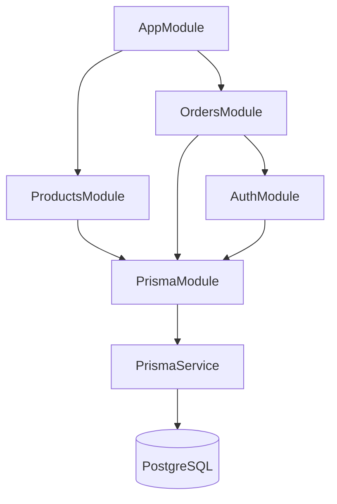
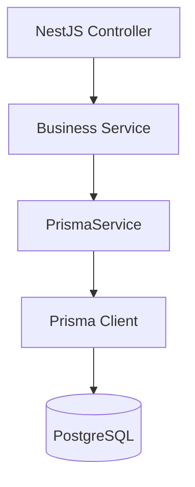
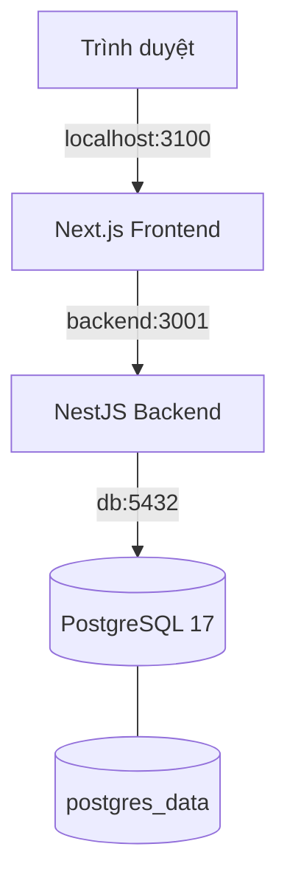

# BrewLite Assignment 2 — Kiến trúc hệ thống

**Task:** A2-ARCH — Task 3.1
**Phụ trách:** Thành viên D
**Reviewer dự kiến:** Thành viên E
**Trạng thái:** Draft — chờ review
**Ngày cập nhật:** 13/11/2026

## 1. Mục tiêu và phạm vi

Tài liệu mô tả kiến trúc tổng thể của hệ thống BrewLite Assignment 2, bao gồm cách tổ chức các thành phần, phân chia trách nhiệm, quan hệ phụ thuộc, chiến lược dữ liệu và các quyết định thiết kế.

Tài liệu được xây dựng dựa trên source của repository `BrewLite-Assignment2`, nhánh `main` tại commit `3be4a11`.

Phần kiến trúc Frontend/BFF/PWA kế thừa tài liệu `docs/architecture/frontend-bff-pwa.md` do thành viên A đóng góp. Phần Docker Compose và Product BFF đối chiếu với PR A2 #7 của thành viên E.

### 1.1. Công nghệ sử dụng

| Thành phần | Công nghệ                        |
| ---------- | -------------------------------- |
| Frontend   | Next.js, TypeScript              |
| Backend    | NestJS, TypeScript               |
| Database   | PostgreSQL 17                    |
| ORM        | Prisma 7.10.1                    |
| Container  | Docker, Docker Compose           |
| PWA        | Web App Manifest, Service Worker |

### 1.2. Kiến trúc phân lớp

BrewLite A2 được tổ chức thành bốn tầng logic chính:

1. **Presentation Layer:** Next.js và Client Components cung cấp giao diện sản phẩm, giỏ hàng, xác thực và đặt hàng.
2. **BFF Layer:** Next.js Route Handlers làm trung gian cho các yêu cầu cần xử lý phía server, bao gồm Auth, Orders và Product BFF.
3. **Business Layer:** NestJS Controllers, Services, Guards và DTO xử lý API, xác thực, kiểm tra dữ liệu và nghiệp vụ.
4. **Persistence Layer:** Prisma cung cấp khả năng truy cập PostgreSQL để lưu trữ dữ liệu bền vững.

Trong cấu hình Docker Compose local, trình duyệt truy cập Next.js tại `http://localhost:3100`. Frontend kết nối đến backend qua `http://backend:3001`, còn backend kết nối PostgreSQL qua `db:5432`.

### 1.3. Giới hạn xác nhận

Tại thời điểm lập tài liệu, Prisma schema có trạng thái đơn hàng `PENDING` và chưa có model thanh toán riêng. Không coi các chức năng thanh toán, quản lý tồn kho, điểm thưởng hoặc Checkout E2E của Assignment 1 là đã được tích hợp và nghiệm thu trong Assignment 2.

Docker Compose local và các kết quả kiểm thử do E báo cáo không thay thế bằng chứng triển khai production hoặc kiểm thử nghiệp vụ end-to-end.

## 2. Kiến trúc module Backend NestJS

### 2.1. Cấu trúc module

Backend BrewLite A2 được tổ chức theo các module nghiệp vụ và module hạ tầng, sử dụng cơ chế Dependency Injection của NestJS.

Sơ đồ mô tả các quan hệ import module được xác nhận từ source. Quan hệ giữa PrismaService và PostgreSQL thể hiện luồng truy cập dữ liệu, không phải quan hệ import module NestJS.

### 2.2. Trách nhiệm của từng module

| Module         | Trách nhiệm                                          | Thành phần                                |
| -------------- | ---------------------------------------------------- | ----------------------------------------- |
| AppModule      | Module gốc, tổ chức các module chính và health check | HealthController                          |
| ProductsModule | Cung cấp chức năng API sản phẩm                      | ProductsController, ProductsPrismaService |
| OrdersModule   | Cung cấp chức năng API đơn hàng                      | OrdersController, OrdersService           |
| AuthModule     | Cung cấp chức năng xác thực và bảo vệ API            | AuthController, AuthService, AuthGuard    |
| PrismaModule   | Cung cấp PrismaService cho các module khác           | PrismaService                             |

### 2.3. Quan hệ phụ thuộc

- `AppModule` import `ProductsModule` và `OrdersModule`.
- `ProductsModule` import `PrismaModule`.
- `OrdersModule` import `PrismaModule` và `AuthModule`.
- `AuthModule` import `PrismaModule`.
- `PrismaModule` export `PrismaService`.
- `AuthModule` export `AuthService` và `AuthGuard`.

`AuthModule` không được import trực tiếp trong `AppModule` tại phiên bản source đã khảo sát, mà được import thông qua `OrdersModule`.

### 2.4. Dependency Injection

NestJS sử dụng Dependency Injection để cung cấp các đối tượng phụ thuộc cho controller và service.

Ví dụ, `PrismaModule` đăng ký `PrismaService` trong `providers` và công khai thông qua `exports`. Module khác có thể import `PrismaModule` để sử dụng provider này.

Cách tổ chức này giúp:

- Tách trách nhiệm giữa controller, service và lớp truy cập dữ liệu.
- Hạn chế khởi tạo thủ công các dependency.
- Hỗ trợ thay thế dependency bằng mock trong unit test.
- Dễ mở rộng hoặc bảo trì các module nghiệp vụ.

### 2.5. Nguyên tắc phân lớp

- **Controller:** Tiếp nhận request và trả response.
- **Service:** Thực hiện logic nghiệp vụ.
- **Guard:** Kiểm tra điều kiện truy cập.
- **PrismaService:** Cung cấp khả năng truy cập cơ sở dữ liệu.

Đây là cách phân chia trách nhiệm ở mức kiến trúc. Chi tiết từng endpoint và luồng xử lý cần đối chiếu với implementation và test tương ứng.

## 3. Kiến trúc dữ liệu, Migration và Mock

### 3.1. Kiến trúc dữ liệu

BrewLite A2 sử dụng PostgreSQL làm hệ quản trị cơ sở dữ liệu quan hệ và Prisma làm lớp truy cập dữ liệu.

Luồng truy cập dữ liệu tổng quát:

Đây là sơ đồ kiến trúc logic. Một số module có thể sử dụng service truy cập dữ liệu chuyên biệt, ví dụ `ProductsPrismaService`.

### 3.2. Mô hình dữ liệu

Prisma schema hiện có 9 model:

| Nhóm           | Model            | Vai trò                                |
| -------------- | ---------------- | -------------------------------------- |
| Catalog        | Product          | Thông tin sản phẩm                     |
| Catalog        | Topping          | Thông tin topping                      |
| Catalog        | ProductTopping   | Quan hệ sản phẩm và topping            |
| Authentication | User             | Tài khoản người dùng                   |
| Authentication | AuthSession      | Phiên đăng nhập                        |
| Orders         | Order            | Đơn hàng                               |
| Orders         | OrderItem        | Chi tiết món trong đơn                 |
| Orders         | OrderItemTopping | Topping của từng món                   |
| Orders         | OrderRequest     | Ghi nhận kết quả xử lý yêu cầu tạo đơn |

Schema định nghĩa hai enum:

- `OrderStatus`: `PENDING`.
- `OrderRequestState`: `SUCCEEDED`, `REJECTED`.

Các trường `requestKey`, `requestHash` và ràng buộc unique theo `userId + requestKey` hỗ trợ thiết kế xử lý yêu cầu tạo đơn có tính idempotency.

### 3.3. Chiến lược Migration

Repository hiện có hai migration:

1. `20261024160346_init_products`
2. `20261030152601_sprint2_auth_orders`

Các script backend liên quan:

| Script        | Mục đích                  |
| ------------- | ------------------------- |
| `db:generate` | Generate Prisma Client    |
| `db:validate` | Kiểm tra Prisma schema    |
| `db:migrate`  | Chạy `prisma migrate dev` |
| `db:seed`     | Chạy `prisma db seed`     |

Đề xuất quy trình quản lý schema:

1. Thay đổi `schema.prisma` trên nhánh tính năng.
2. Tạo migration mới trong môi trường phát triển.
3. Review migration SQL trước khi merge.
4. Kiểm tra migration trên database A2 riêng biệt.
5. Khi triển khai production, sử dụng quy trình áp dụng migration đã được kiểm duyệt, thay vì tạo migration mới trực tiếp trên production.

Lệnh `prisma migrate deploy` là phương án triển khai migration production được đề xuất; chưa được xác nhận là script đã tích hợp trong pipeline A2.

Không chạy `prisma migrate reset` hoặc các thao tác xóa dữ liệu trên database đang chứa dữ liệu cần bảo toàn.

### 3.4. Chiến lược Seed

Repository có file `apps/api/prisma/seed.ts` và script `db:seed`.

Seed được sử dụng để chuẩn bị dữ liệu phục vụ phát triển, kiểm thử hoặc demo, tùy theo implementation.

Nội dung và tính lặp lại an toàn của seed cần được kiểm tra trực tiếp trước khi đưa ra kết luận về dữ liệu được tạo.

### 3.5. Chiến lược Mock và Test Data

Đề xuất phân chia môi trường kiểm thử:

| Loại kiểm thử        | Chiến lược                                                            |
| -------------------- | --------------------------------------------------------------------- |
| Unit test            | Mock dependency hoặc PrismaService khi phù hợp                        |
| API integration test | Sử dụng database A2 riêng, migration và dữ liệu kiểm thử có kiểm soát |
| Frontend test        | Mock HTTP response hoặc dùng fixture theo mục tiêu test               |
| End-to-end test      | Sử dụng các service thực trong môi trường kiểm thử độc lập            |

Mock giúp kiểm tra logic riêng lẻ nhưng không thay thế được kiểm thử tích hợp thực tế với PostgreSQL.

Dữ liệu của Assignment 1 và Assignment 2 phải được tách biệt. Không dùng chung database hoặc sao chép cấu hình bí mật giữa hai repository khi chưa được kiểm soát.

### 3.6. Giới hạn hiện tại

Prisma schema đã khảo sát chưa có model thanh toán riêng, chưa có trường tồn kho trên Product và chưa có cấu trúc điểm thưởng.

Vì vậy, các chức năng Payment, Stock và Points từ Assignment 1 không được coi là đã hoàn thành trong Assignment 2 chỉ dựa trên kết quả kiểm thử hoặc tài liệu của Assignment 1.

## 4. Triển khai local, Trade-off và quyết định kiến trúc

### 4.1. Kiến trúc Docker Compose

BrewLite A2 sử dụng Docker Compose để tổ chức môi trường chạy local với ba service:

| Service  | Vai trò               | Kết nối                                  |
| -------- | --------------------- | ---------------------------------------- |
| frontend | Chạy ứng dụng Next.js | Host `127.0.0.1:3100` → container `3000` |
| backend  | Chạy NestJS API       | Container `3001`                         |
| db       | Chạy PostgreSQL 17    | Container `5432`                         |

Sơ đồ triển khai:

Theo `compose.yaml` đã khảo sát:

- Database sử dụng tên `brewlite_a2`.
- Backend phụ thuộc vào database đạt trạng thái healthy.
- Frontend phụ thuộc vào backend đạt trạng thái healthy.
- Frontend sử dụng `BACKEND_INTERNAL_URL=http://backend:3001`.
- Database sử dụng named volume `postgres_data` để lưu dữ liệu.
- `POSTGRES_PASSWORD` và `AUTH_JWT_SECRET` là các biến môi trường bắt buộc.

Tài liệu cấu hình chi tiết: `docs/assignment2/COMPOSE.md`.

Đây là kiến trúc triển khai local. Không coi Docker Compose local là bằng chứng hệ thống đã triển khai production.

### 4.2. Các đánh đổi thiết kế (Trade-off)

| Quyết định           | Lợi ích                                                                         | Đánh đổi                                                     |
| -------------------- | ------------------------------------------------------------------------------- | ------------------------------------------------------------ |
| Next.js BFF          | Tập trung xử lý các request phía server, hỗ trợ che giấu địa chỉ backend nội bộ | Tăng một lớp xử lý và độ phức tạp vận hành                   |
| NestJS module hóa    | Phân chia trách nhiệm, hỗ trợ Dependency Injection và kiểm thử                  | Cần quản lý phụ thuộc giữa các module                        |
| Prisma ORM           | Schema rõ ràng, hỗ trợ type safety và migration                                 | Phụ thuộc vào quy trình generate client và quản lý migration |
| PostgreSQL           | Hỗ trợ dữ liệu quan hệ, ràng buộc và transaction                                | Cần quản lý kết nối, backup và vận hành database             |
| Docker Compose       | Môi trường local nhất quán, dễ phối hợp các service                             | Không tự cung cấp quy trình production, scaling hay giám sát |
| Mock trong unit test | Test nhanh, cô lập logic                                                        | Không chứng minh được tương tác thật với database và network |

### 4.3. Các quyết định kiến trúc (ADR)

Các ADR dưới đây ghi lại những lựa chọn hiện có hoặc đề xuất cần review. Việc ghi nhận trong tài liệu không đồng nghĩa mọi quyết định đã được nhóm phê duyệt.

**ADR-001 — Phân chia Frontend/BFF và Backend API**

- Trạng thái: Ghi nhận kiến trúc hiện tại.
- Quyết định: Sử dụng Next.js cho giao diện và các BFF Route Handlers; NestJS đảm nhiệm API và nghiệp vụ.
- Lý do: Phân tách giao diện, xử lý request phía server và logic nghiệp vụ.
- Hệ quả: Cần quản lý hợp đồng API, cookie/session và cấu hình kết nối giữa các service.
- Tham chiếu: `docs/architecture/frontend-bff-pwa.md` và Product BFF trong PR A2 #7.

**ADR-002 — PostgreSQL và Prisma**

- Trạng thái: Ghi nhận kiến trúc hiện tại.
- Quyết định: Sử dụng PostgreSQL làm database và Prisma để định nghĩa schema, truy cập dữ liệu, quản lý migration.
- Lý do: Dữ liệu sản phẩm, người dùng và đơn hàng có quan hệ và ràng buộc rõ ràng.
- Hệ quả: Cần quản lý migration có phiên bản, generate Prisma Client và kiểm thử tích hợp với database thực.

**ADR-003 — Tách môi trường và dữ liệu A2 khỏi A1**

- Trạng thái: Đề xuất quy trình, chờ review.
- Quyết định đề xuất: Sử dụng database và cấu hình môi trường riêng cho Assignment 2; không mặc định tái sử dụng database A1.
- Lý do: Tránh xung đột schema, migration và dữ liệu giữa hai repository.
- Hệ quả: Cần chuẩn bị database, secrets, migration và seed độc lập.

**ADR-004 — Kết hợp Mock Test và Integration Test**

- Trạng thái: Đề xuất chiến lược kiểm thử, chờ review.
- Quyết định đề xuất: Sử dụng mock cho unit test; sử dụng PostgreSQL và các service thực cho integration/E2E test.
- Lý do: Cân bằng tốc độ kiểm thử với khả năng phát hiện lỗi tích hợp.
- Hệ quả: Cần chuẩn bị dữ liệu kiểm thử, cô lập môi trường và thu thập bằng chứng PASS/FAIL.

### 4.4. Rủi ro và nội dung cần xác nhận

1. Chưa có bằng chứng đầy đủ về luồng Payment/Checkout E2E trong A2.
2. Chưa xác nhận pipeline triển khai production và kết quả kiểm thử trên môi trường production.
3. Cần kiểm tra nội dung seed, tính an toàn khi chạy lại và dữ liệu demo.
4. Cần xác nhận chiến lược migration production với thành viên E.
5. Cần đối chiếu hợp đồng API và các luồng Auth/Orders với implementation và test hiện tại.

### 4.5. Tiêu chí review Task 3.1

Thành viên E review tài liệu theo các tiêu chí:

- Sơ đồ kiến trúc phù hợp với source A2.
- Quan hệ phụ thuộc module NestJS chính xác.
- Kiến trúc database và migration được mô tả rõ.
- Chiến lược mock và integration test phân biệt đúng phạm vi.
- Trade-off và ADR có lý do, hệ quả và trạng thái rõ ràng.
- Không nhầm lẫn kết quả A1 với bằng chứng hoàn thành A2.

Tài liệu chỉ được chuyển từ Draft sang Reviewed sau khi có phản hồi review và xử lý các vấn đề cần sửa.
