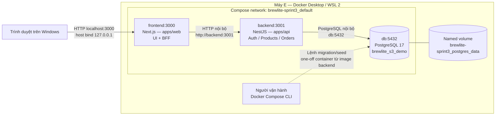
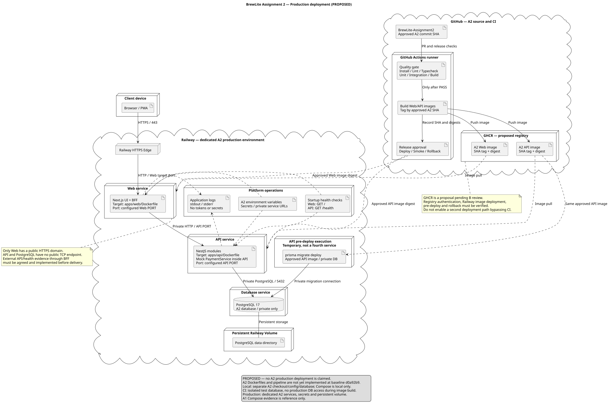
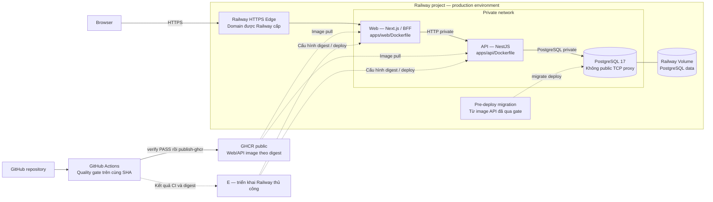

# Task 3.2 — Deployment BrewLite

Ngày lập: 10/11/2026.
Lead: E. Reviewer: C.

Trạng thái: Đã triển khai Railway và kiểm chứng thủ công luồng tạo đơn
PENDING trên HTTPS. Các phần thanh toán, rollback và backup/restore
chưa được kiểm chứng trên production.

Nguồn thiết kế kế thừa:
[PR A1 #44](https://github.com/giabaot400-boop/BrewLite/pull/44),
commit 1952ea6. Bằng chứng A1 chỉ có giá trị tham khảo,
không thay thế bằng chứng chạy source A2.

Bằng chứng local A2: [COMPOSE.md](COMPOSE.md).

Bằng chứng Railway A2:
[PR #15](https://github.com/giabaot400-boop/BrewLite-Assignment2/pull/15),
commit báo cáo 7009009.

Image production được build từ source SHA
0bea2e2015c54cf23cb1d3b9f32bc146d2891136;
không đồng nghĩa với HEAD mới nhất trên main đã được triển khai.

## 1. Deployment local tham khảo — đã chạy tại A1

- Chỉ frontend publish cổng host 127.0.0.1:3000.
- Backend và database không publish cổng ra host.
- Browser gọi Product API qua /api/products.
- BFF và frontend server dùng BACKEND_INTERNAL_URL.
- Mock payment theo thiết kế chạy bên trong backend;
  chưa tích hợp workflow payment trong bản local này.
- Không có container payment gateway hoặc queue riêng.
- PostgreSQL Docker tách khỏi PostgreSQL cài trên Windows.

## 2. Ánh xạ tạo phẩm

| Thành phần | Tạo phẩm/cấu hình |
|---|---|
| Frontend | apps/web/Dockerfile, brewlite-web:sprint3 |
| Backend | apps/api/Dockerfile, brewlite-api:sprint3 |
| Database | postgres:17-bookworm |
| Điều phối | compose.yaml, đúng ba service |
| Dữ liệu bền | Named volume của service db |
| Secret local | .env.compose, không commit hoặc đưa vào image |
| Hướng dẫn chạy A1 | [Tài liệu nguồn A1](https://github.com/giabaot400-boop/BrewLite/blob/c7eb6c9/docs/SPRINT3_COMPOSE.md); chưa phải hướng dẫn A2 |
| Migration | apps/api/prisma/migrations |
| Catalog seed | apps/api/prisma/seed.ts |
| Demo seed | apps/api/prisma/seed-demo.ts |

## 3. Khởi động và kiểm tra

1. Build hai image theo lockfile.
2. Khởi động db và đợi pg_isready thành công.
3. Người vận hành chạy migrate deploy một lần.
4. Seed catalog; khởi tạo tồn demo có guard khi fixture mới.
5. Khởi động backend và frontend.
6. Backend kiểm tra /health; frontend kiểm tra HTTP /.
7. Smoke /api/products và kiểm tra dữ liệu PostgreSQL.

Migration/seed không tự chạy đồng thời ở mỗi app container.
Backend chờ db healthy; frontend chờ backend healthy.
UTC được cấu hình cho kết nối backend và demo seed.
Không dùng down -v trên dữ liệu cần giữ.

## 4. Bằng chứng local A1 — chưa tái kiểm chứng tại A2

Đã thực hiện trên máy E:
- Build hai image thành công.
- Ba migration áp dụng trên database Docker sạch.
- Seed catalog và demo thành công.
- Ba service Healthy.
- /api/products trả 200, đủ bốn sản phẩm.
- Bốn Product: stock 10, reservedStock 0, stockVersion 1.
- DEMO10 lưu đúng các mốc UTC.
- Restart container: API vẫn 200, còn bốn sản phẩm,
  tổng tồn 40.
- Đã quan sát menu và trang chi tiết sản phẩm trên trình duyệt;
  bằng chứng được cập nhật tại commit c7eb6c9.

Giới hạn:
- Chưa xác nhận chạy trên máy thành viên khác.
- Chưa xác nhận toàn luồng auth/cart/payment trong Docker.
- Chưa kiểm thử backup/restore hoặc rollback deployment.
- Healthcheck không thay bằng chứng nghiệp vụ/E2E.

## 5. Production Railway — cấu hình đã triển khai và phần còn thiếu

Ngày 14/11/2026, E triển khai Web Next.js, API NestJS và PostgreSQL 17
trên Railway. Web/API sử dụng image GHCR theo digest,
được build từ source SHA 0bea2e2015c54cf23cb1d3b9f32bc146d2891136.

Đã kiểm chứng migration, seed catalog, đăng nhập và tạo đơn PENDING
qua HTTPS. Chi tiết tại PR A2 #15.
Compose giữ cho local; ngân sách và chi phí thực tế cần xác nhận riêng.

### 5.1 UML deployment production
Nguồn UML: [deployment-production.puml](deployment-production.puml).

Sơ đồ Mermaid bên dưới là bản tóm tắt luồng triển khai.

Sơ đồ mô tả đường triển khai thủ công đã chạy với image từ source SHA
0bea2e2. Bằng chứng nghiệp vụ giới hạn ở luồng tạo đơn PENDING;
không xác nhận thanh toán, rollback hoặc backup/restore.
Không tạo thêm service payment gateway hoặc queue.
Migration là bước chạy tạm thời, không phải service thứ tư thường trực.
Mock payment vẫn ở trong backend theo thiết kế nghiệp vụ.

### 5.2 Cấu hình service đã triển khai

Web/API dùng image GHCR theo digest từ source SHA 0bea2e2.
Railway pull image đã build; không build trực tiếp từ repository.

| Thành phần | Cấu hình thực tế |
|---|---|
| Web | Service BrewLite, image brewlite-a2-web từ GHCR, port 3000 |
| API | Service BrewLite-Assignment2, image brewlite-a2-api từ GHCR, port 3001 |
| Database | Service postgres, image postgres:17-bookworm; log xác nhận 17.12 |
| Database name | brewlite_a2 |
| Volume | postgres-volume-gGFY, mount /var/lib/postgresql/data |
| PGDATA | /var/lib/postgresql/data/pgdata |
| Public HTTPS | https://brewlite-production.up.railway.app, target port 3000 |
| API private | brewlite-assignment2.railway.internal:3001 |
| DB private | postgres-99de976c.railway.internal:5432 |
| Healthcheck | Web `/`, API `/health` |
| Replica | Một replica mỗi service; chưa xác nhận high availability |

Biến môi trường runtime:

- Web: NODE_ENV=production, TZ=UTC, PORT=3000.
- BACKEND_INTERNAL_URL=http://brewlite-assignment2.railway.internal:3001.
- APP_ORIGIN=https://brewlite-production.up.railway.app.
- AUTH_COOKIE_NAME=brewlite_a2_session.
- API: NODE_ENV=production, TZ=UTC, PORT=3001.
- FRONTEND_ORIGIN=https://brewlite-production.up.railway.app.
- DATABASE_URL dùng database brewlite_a2 và hostname private của postgres.
- AUTH_JWT_SECRET và mật khẩu database được lưu trong Railway variables;
  không ghi giá trị vào tài liệu.

Đã kiểm chứng kết nối Web → API → PostgreSQL qua luồng tạo đơn.
API và PostgreSQL không được cấu hình public domain/TCP proxy.

Giới hạn và yêu cầu cấu hình:

- Web image chạy next start --port 3000; target port giữ 3000.
- NEXT_PUBLIC_* là cấu hình build-time; thay runtime không thay bundle đã build.
- Không đưa secret hoặc hostname private vào NEXT_PUBLIC_*.
- Đăng nhập và tạo đơn qua HTTPS đã chạy; chưa kiểm chứng đầy đủ
  các trường hợp cookie, CSRF và ownership trên production.
- TZ=UTC đã cấu hình; chưa có kiểm thử riêng round-trip thời gian.
- Database image hiện ghim major 17 bằng tag; chưa ghi digest database.
- Service Postgres 18 ban đầu và volume riêng vẫn còn,
  cần xác nhận không sử dụng trước khi dọn.

### 5.3 Tài khoản và quyền

- Nhóm chỉ định Owner tài khoản/project, người duyệt và chịu billing.
- E cần quyền deploy, cấu hình service/variables/volume và xem log.
- B phối hợp quyền GitHub repository, workflow và GitHub integration.
- C/D cung cấp cấu hình ứng dụng và xử lý lỗi auth/workflow.
- Dùng tài khoản cá nhân và lời mời phân quyền, không chia sẻ mật khẩu.
- Nếu dùng CLI/CD token: lưu trong GitHub Secrets, giới hạn phạm vi
  project/environment khi nền tảng hỗ trợ.
- Gói Hobby/Pro và quyền cộng tác thực tế phải được kiểm tra
  trước khi nhóm duyệt; chưa có xác nhận tài khoản hiện hành.
Quyền registry:
- CI #32 đã publish thành công hai package GHCR của repo A2.
- Hai package đang public; Railway đã pull và chạy image theo digest.
- Lần triển khai này không kiểm chứng pull private image.
- Nếu chuyển package sang private, cần cấu hình credential chỉ có
  quyền read:packages và kiểm chứng lại trước phát hành.
- Job publish cần quyền packages:write; credential không được ghi
  vào Git, image hoặc log.
### 5.4 Quality gate, registry và phát hành

Đã kiểm chứng cho bản production:
- Source SHA: 0bea2e2015c54cf23cb1d3b9f32bc146d2891136.
- CI #32 trên main: verify và publish-ghcr đều PASS.
- Link: https://github.com/giabaot400-boop/BrewLite-Assignment2/actions/runs/43546562005
- Web/API image được publish lên GHCR, có tag theo SHA và digest.
- Hai package đang public; lần triển khai này không dùng credential
  để pull private image.
- Railway Web/API dùng image theo digest của bản phát hành trên.
- Đã ngắt nguồn GitHub của hai service; không dùng GitHub source autodeploy.
- Cấu hình và deploy Railway được thực hiện thủ công sau khi CI PASS.
- Chưa có bằng chứng pipeline tự động deploy Railway.

Phạm vi verify được đối chiếu:
- Cài đặt theo lockfile, sinh Prisma Client.
- Lint apps/web; typecheck và unit test web/API.
- Test cấu hình local và build web/API.
- PostgreSQL integration/E2E không được suy ra từ kết quả verify này.

Giới hạn:
- CI PASS của một lượt chạy chưa chứng minh gate thất bại sẽ chặn
  mọi đường deploy thủ công trên Railway.
- Branch protection và bằng chứng chặn merge xem tài liệu CI.md;
  không suy ra trạng thái chỉ từ việc verify PASS.
- Chỉ phát hành image đã được duyệt và ghi lại digest.
- Không đưa secret vào Git, image hoặc log.

Bằng chứng triển khai và smoke:
[PR A2 #15](https://github.com/giabaot400-boop/BrewLite-Assignment2/pull/15).

Main hiện tại có thể mới hơn source SHA của image đang chạy.
Kết quả kiểm chứng bản production trên không tự áp dụng cho các commit mới.

### 5.5 Migration, seed, health và rollback

Đã chạy trên Railway với image từ source SHA 0bea2e2:

- API pre-deploy:
  `npm exec --workspace apps/api -- prisma migrate deploy`
- Kết nối thành công tới database brewlite_a2 qua mạng private.
- Áp dụng thành công 2 migration:
  - 20261024160346_init_products
  - 20261030152601_sprint2_auth_orders
- Khi redeploy API, pre-deploy báo:
  `No pending migrations to apply`.
- Chỉ API chạy migration; Web không chạy migration.
- Seed catalog được chạy thủ công trong container API:
  `npm run db:seed --workspace apps/api`.
- Seed thành công 4 sản phẩm và 2 topping mẫu.
- Seed không nằm trong pre-deploy và không chạy lại khi redeploy API.
- API healthcheck `/health`; Web healthcheck `/`.
- Web/API đạt trạng thái Active/Online.
- HTTPS Product BFF trả 200 và đủ 4 sản phẩm.
- Đăng nhập và tạo đơn PENDING 57.000đ qua giao diện thành công.
- Database xác nhận ledger SUCCEEDED và request hash khớp Order.
- Catalog và đơn hàng còn nguyên sau redeploy API.

Giới hạn kiểm chứng:

- Đây là smoke thủ công cho luồng tạo đơn của bản production trên.
- Chưa kiểm chứng thanh toán, hoàn tiền, loyalty, cancel hoặc expiry.
- Redeploy API không thay thế kiểm tra restart/redeploy PostgreSQL.
- Healthcheck khởi động không thay thế giám sát liên tục.
- Chưa thực hiện rollback ứng dụng hoặc backup/restore database.

Yêu cầu vận hành tiếp theo:

- Sao lưu trước thay đổi schema; thử migration trên database test/bản sao.
- Rollback ứng dụng bằng digest đã duyệt, chỉ khi tương thích schema.
- Không tự hoàn tác migration hoặc restore đè production.
- Restore cần người duyệt và xác định dữ liệu có thể mất sau thời điểm backup.
- Volume không thay thế backup; cần kiểm thử restore trên database riêng.
- Image chạy migration phải có Prisma CLI, prisma.config.ts,
  dotenv và prisma/migrations.
- Cấp DATABASE_URL lúc chạy; không kết nối production DB trong bước build.
- Không tự chạy seed-demo hoặc INIT_DEMO_STOCK trên production.

Bằng chứng chi tiết:
[PR A2 #15](https://github.com/giabaot400-boop/BrewLite-Assignment2/pull/15).

### 5.6 Dự toán sơ bộ — kiểm tra ngày 10/11/2026

Đơn vị USD, giả định chạy cả tháng với tải thấp.
Đây là giả định sử dụng trung bình, chưa phải số đo Railway.

| Thành phần | RAM trung bình | CPU trung bình | Ước tính/tháng |
|---|---:|---:|---:|
| Web | 0,25 GB | 0,05 vCPU | 3,50 |
| API | 0,25 GB | 0,05 vCPU | 3,50 |
| PostgreSQL | 0,25 GB | 0,05 vCPU | 3,50 |
| Volume 1 GB + egress 10 GB | — | — | 0,65 |
| Tổng giả định | | | 11,15 |

Cơ sở ước tính từ tài liệu Railway:
- RAM khoảng 10 USD/GB/tháng.
- CPU khoảng 20 USD/vCPU/tháng.
- Volume khoảng 0,15 USD/GB/tháng.
- Egress 0,05 USD/GB.
- Hobby tối thiểu 5 USD/tháng, đã bao gồm 5 USD usage;
  không cộng thêm 5 USD vào tổng usage đã vượt mức này.
- Pro tối thiểu 20 USD/tháng, bao gồm 20 USD usage.

Đề xuất nhóm duyệt:
- Hobby: dự phòng 15–25 USD/tháng nếu quyền dùng phù hợp.
- Pro: dự phòng 20–30 USD/tháng nếu cần workspace cộng tác.
- Chưa gồm thuế/phí thanh toán, backup hoặc dịch vụ phụ nếu có.
- Không cam kết Free/Trial đủ tài nguyên hoặc đủ thời gian chấm.
- Chưa bật trả phí. Nhóm phải chọn gói, Owner và ngân sách.
- Cấu hình cảnh báo/giới hạn chi phí sau khi duyệt;
  kiểm tra tác động dừng service khi chạm giới hạn.
- Theo dõi usage thực sau triển khai để cập nhật dự toán.

### 5.7 Trạng thái cần review

Đã chạy thực tế tại A2:
- Docker/Compose local: xem COMPOSE.md.
- CI #32: verify và publish-ghcr PASS cho source SHA 0bea2e2.
- Railway Web/API triển khai thủ công bằng image GHCR theo digest.
- Web có HTTPS: https://brewlite-production.up.railway.app
- API dùng mạng private.
- PostgreSQL 17.12 dùng volume riêng và kết nối private.
- Migration và seed catalog thành công.
- Smoke thủ công: đăng nhập, chọn món, giỏ hàng và tạo đơn PENDING.
- Đơn 57.000đ có ledger SUCCEEDED và request hash khớp trong database.
- Catalog và đơn hàng còn nguyên sau redeploy API.

Bằng chứng:
[PR A2 #15](https://github.com/giabaot400-boop/BrewLite-Assignment2/pull/15).

Các kết quả A1 ở mục 4 chỉ là bằng chứng lịch sử,
không thay thế kiểm chứng A2.

Còn cần hoàn thiện hoặc xác nhận:
- Reviewer xác nhận phạm vi bằng chứng và cấu hình deployment.
- Đồng bộ UML với tên service, domain và cách phát hành thực tế.
- Thanh toán và các workflow checkout còn lại trên production.
- Restart/redeploy PostgreSQL, backup/restore và rollback ứng dụng.
- Pipeline tự động deploy Railway sau quality gate.
- Owner billing, gói/ngân sách được duyệt và chi phí đo thực tế.
- Dọn service Postgres 18 ban đầu sau khi xác nhận không được sử dụng.

Chưa kết luận toàn bộ checkout hoặc nghiệm thu Task 3.2 đã hoàn thành.
## 6. Điều kiện chốt Task 3.2

- Nhóm duyệt Railway, gói sử dụng, Owner và ngân sách.
- E được cấp quyền triển khai; B thống nhất quality gate/CD.
- C review mạng private, secret, HTTPS, health và cấu hình.
- D/E đối chiếu với kiến trúc Task 3.1 và workflow tích hợp.
- Sơ đồ UML deployment khớp cấu hình production dự kiến;
  khi triển khai phải cập nhật tên service/domain thực tế.
- Phân biệt rõ thiết kế đề xuất với bằng chứng đã chạy.
- Ghi SHA, URL, deployment IDs và kết quả kiểm chứng thực tế.
- Các phần chưa đạt tiếp tục ghi CHỜ, không tự đánh dấu PASS.
- Nghiệm thu theo cổng Task 1 → 5 của nhóm.

Bản tài liệu này chưa xác nhận production đã hoạt động.