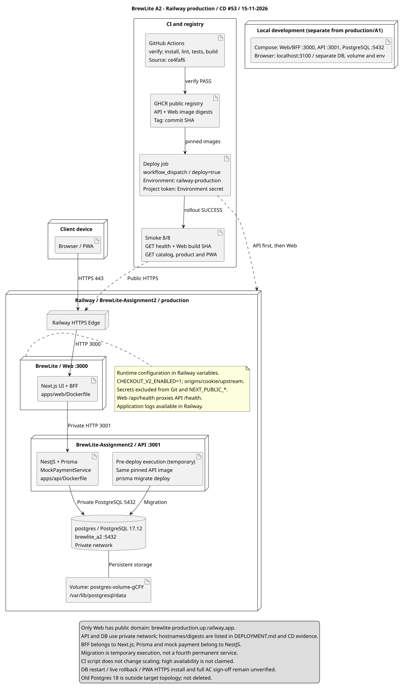

# Task 3.2 — Deployment production BrewLite A2

Cập nhật 15/11/2026. Kế thừa E PR #3/#15; A tích hợp sau CD #53. Sơ đồ phản ánh production được triển khai tại source `ce4faf64f394740108eb8911a1e3076728b85860`. Việc tài liệu được cập nhật không tự nghiệm thu toàn bộ Task 3.2 hoặc mọi AC.

## Tạo phẩm và ranh giới

[Nguồn PlantUML](deployment-production.puml) và [SVG](deployment-production.svg) được kết xuất từ cùng nguồn. [Bản lịch sử 14/11](DEPLOYMENT_HISTORY_2026-11-14.md) giữ đường deploy thủ công/source 0bea2e2; không dùng làm trạng thái hiện tại.

| Vùng | Thành phần và trách nhiệm |
|---|---|
| Client | Browser/PWA, HTTPS tới domain Web; không truy cập DB hoặc API private trực tiếp |
| Local | Compose Web/BFF + API + PostgreSQL 17, Web localhost:3100; DB/volume/env A2 riêng, không nối DB production |
| CI | GitHub Actions verify → publish GHCR → deploy API rồi Web → smoke. Deploy qua workflow_dispatch/deploy=true trên main, Environment railway-production |
| Registry | Public GHCR brewlite-a2-api và brewlite-a2-web; release dùng digest, tag SHA hỗ trợ truy vết |
| Production | Railway environment production: Web, API, PostgreSQL; migration là thực thi tạm từ API image, không là service thứ tư |

## Cấu hình production đã đối chiếu

| Thành phần | Cấu hình |
|---|---|
| Web | Service BrewLite, Next.js UI + BFF cùng ứng dụng, port 3000 |
| Public HTTPS | https://brewlite-production.up.railway.app |
| API | Service BrewLite-Assignment2, NestJS + Prisma + MockPaymentService, port 3001 |
| Web → API | HTTP private, brewlite-assignment2.railway.internal:3001 |
| Database | Service postgres, PostgreSQL 17.12 / postgres:17-bookworm, brewlite_a2 |
| API → DB | PostgreSQL private, postgres-99de976c.railway.internal:5432; không public TCP proxy |
| Storage | postgres-volume-gCFY, mount /var/lib/postgresql/data; dữ liệu tách A1 |
| Health | Web /api/health proxy API /health, no-store; catalog smoke kiểm đọc DB riêng |
| Migration | API pre-deploy: npm exec --workspace apps/api -- prisma migrate deploy; Web không chạy migration |
| Runtime | CHECKOUT_V2_ENABLED=1 ở Web, origin/cookie/private upstream theo [hướng dẫn](../deployment.md) |
| Logging/secret | App logs tại Railway; runtime secrets tại Railway variables, project token trong GitHub Environment secret; không đưa giá trị vào repo/image/NEXT_PUBLIC_* |

Postgres 18 ban đầu còn tồn tại ngoài topology mục tiêu; không tự xóa service/volume khi chưa xác nhận không dùng. Không kết luận high availability hoặc số replica từ trường numReplicas nullable. Script CD không gửi cấu hình scaling.

## Đường phát hành đã chạy

[CI #53](https://github.com/giabaot400-boop/BrewLite-Assignment2/actions/runs/43682250369) đã verify, publish, deploy và smoke thành công. Migration chạy trước API mới; script chờ API SUCCESS rồi mới đổi Web. Smoke so Web build SHA, kiểm catalog và PWA 8/8. [Báo cáo và hai JSON](testing/railway-production-2026-11-15/README.md) giữ digest, deployment ID, pin trước đó và giới hạn.

Bước approve/kích hoạt thủ công không thay việc rollout được CI thực hiện bằng secret. Không dùng latest làm định danh release. Khi lỗi dừng pipeline; không tự reverse migration hay restore đè production. Lượt CD đỏ do preflight replica được sửa qua #18; CD xanh không là bằng chứng đã thử rollback live.

## Vận hành và giới hạn

Dùng [docs/deployment.md](../deployment.md) làm hướng dẫn thao tác chính; [runbook](DEPLOY_RUNBOOK.md) tóm tắt xử lý sự cố. Kho đã được khởi tạo một lần, giữ 2 đơn legacy; không chạy lại initializer hoặc SQL cấp kho trực tiếp. Backup/restore thử được ghi riêng theo xác nhận A; không coi volume là backup.

Thanh toán/hủy mock trên Web bootstrap đã được A thử; không có cổng thanh toán tiền thật. PWA HTTPS install/offline, DB restart, rollback production và benchmark vẫn chưa có bằng chứng trong lượt này. Chi phí ước tính cũ chỉ nằm trong bản lịch sử; không là số đo usage hay cam kết trial đủ thời gian chấm. Nhóm cần giữ URL hoạt động đến khi chấm và tự xác nhận billing.
