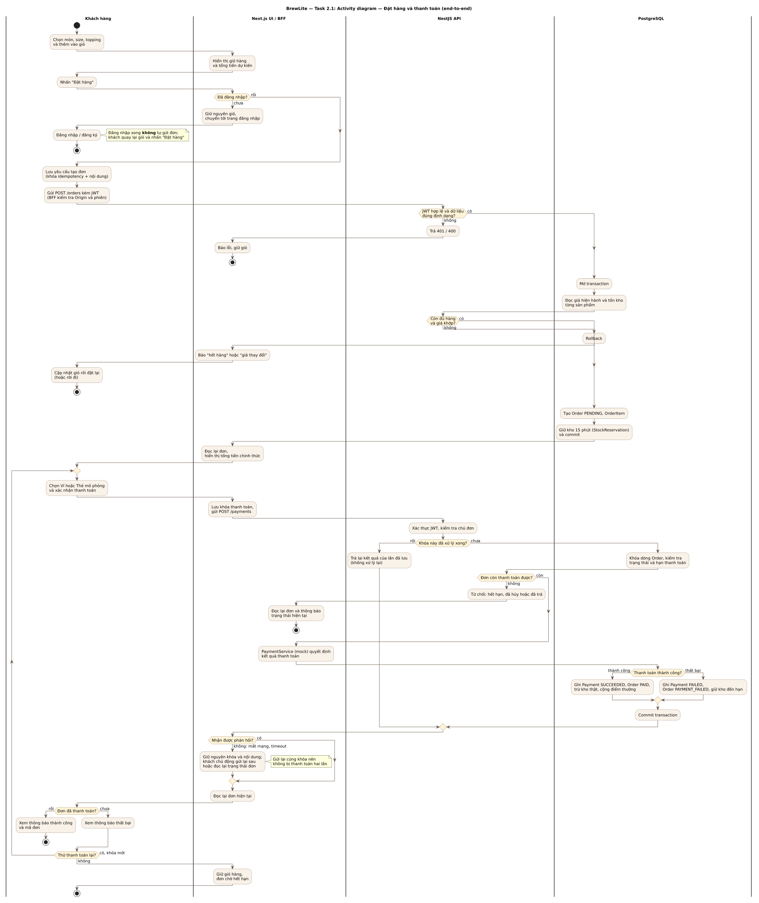

# Task 2.1 — Activity diagram: đặt hàng và thanh toán

| Thông tin | Giá trị |
|---|---|
| Nguồn / hình | [activity-checkout.puml](activity-checkout.puml) · [activity-checkout.svg](activity-checkout.svg) |
| Căn cứ | [SRS](../requirements/srs.md), [UC-09](../requirements/use-case-checkout.md), [ngữ cảnh hỗ trợ](../requirements/checkout-supporting-flows.md), [contract](../assignment2/CONTRACTS.md) |
| Trạng thái | Bản vẽ lại theo đề Task 2.1; chờ reviewer (D) duyệt, chưa nghiệm thu |

## Đối chiếu yêu cầu Task 2.1

| Yêu cầu của đề | Có trong hình |
|---|---|
| Điểm bắt đầu và kết thúc | Một điểm bắt đầu; nhiều điểm kết thúc theo từng nhánh |
| Hành động người dùng và hệ thống | Bốn swimlane: Khách hàng, Next.js UI/BFF, NestJS API, PostgreSQL |
| Decision/merge nhánh thành công và thất bại | Kiểm tra JWT/DTO, đủ hàng/giá khớp, khóa đã xử lý, còn thanh toán được, thanh toán thành công, thử lại |
| Chưa đăng nhập | Giữ giỏ, chuyển đăng nhập, **không** tự gửi đơn sau khi đăng nhập |
| Hết hàng | Rollback, báo hết hàng/giá thay đổi, khách cập nhật giỏ |
| Thanh toán thất bại | Payment FAILED, Order PAYMENT_FAILED, giữ kho đến hạn |
| Chưa rõ kết quả (timeout, mất phản hồi) | Không kết luận FAILED chỉ vì Order chưa PAID; giữ nguyên owner/khóa/nội dung, khách chủ động gửi lại **cùng khóa** (vòng lặp trong); chưa xác nhận thì giữ recovery, không cho khóa mới |
| Thử lại sau FAILED | Chỉ khi FAILED đã xác nhận, không còn recovery chưa rõ và đơn còn hạn; dùng khóa mới trên cùng Order, đi PAYMENT_FAILED → PENDING → kết quả cuối trong một transaction |

PaymentService là bước nội bộ NestJS (mock), nên nằm trong lane NestJS API. Khóa đã có attempt commit thì replay, không lặp tác động kho/điểm; khóa chưa có attempt (request trước chưa tới server hoặc đã rollback) được xử lý như lần đầu. BFF chuyển token sang NestJS dưới dạng Bearer.

## Giới hạn

Hình là thiết kế để review, không chứng minh code đã chạy hay AC đã đạt. Hủy đơn và hết hạn tự động là luồng liên quan, mô tả ở [ngữ cảnh hỗ trợ](../requirements/checkout-supporting-flows.md), không vẽ riêng ở đây.
