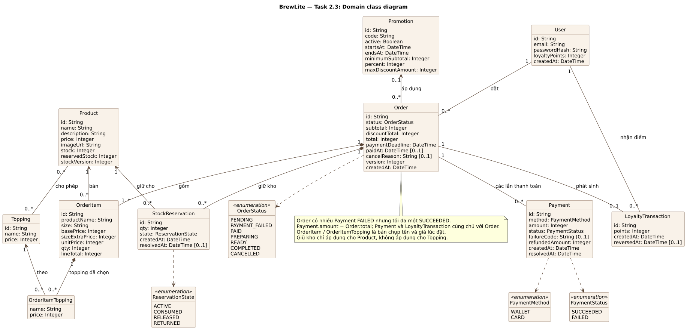

# Task 2.3 — Class diagram mức domain

| Thông tin | Giá trị |
|---|---|
| Nguồn / hình | [class-domain.puml](class-domain.puml) · [class-domain.svg](class-domain.svg) |
| Căn cứ | [SRS](../requirements/srs.md), [UC-09](../requirements/use-case-checkout.md), [contract checkout tham khảo](../reference/a1/checkout-contract.md) |
| Trạng thái | Bản vẽ lại theo đề Task 2.3; chờ reviewer (D) duyệt, chưa nghiệm thu |

## Đối chiếu yêu cầu Task 2.3

| Yêu cầu của đề | Có trong hình |
|---|---|
| Lớp tối thiểu: User, Product, Order, OrderItem, Payment, Promotion, LoyaltyTransaction | Đủ bảy lớp |
| Lớp bổ trợ | Topping, OrderItemTopping (bản chụp topping), StockReservation (giữ kho) |
| Thuộc tính chính | Mỗi lớp có thuộc tính chính; `[0..1]` là giá trị có thể rỗng |
| Quan hệ và multiplicity | Ví dụ User 1–0..* Order, Order 1–1..* OrderItem (composition), Order 1–0..* Payment |
| Enum trạng thái | OrderStatus, PaymentStatus, PaymentMethod, ReservationState |

## Quy tắc ngoài hình

- Một Order có nhiều Payment FAILED nhưng tối đa một SUCCEEDED; `Payment.amount = Order.total`.
- Payment và LoyaltyTransaction cùng chủ với Order.
- `paymentDeadline` có thể rỗng với đơn legacy (chưa có hạn thanh toán và giữ kho).
- OrderItem và OrderItemTopping lưu bản chụp tên/giá lúc đặt.
- Chỉ Product có tồn kho và giữ kho; Topping thì không.
- Payment tương ứng `PaymentAttempt`, LoyaltyTransaction tương ứng `LoyaltyEntry` trong thiết kế dữ liệu; các trường khóa idempotency, hash, AuthSession và OrderRequest không vẽ ở mức domain.

## Giới hạn

Hình là mô hình domain để review, không thay schema Prisma hay migration, và không chứng minh code đã chạy.
