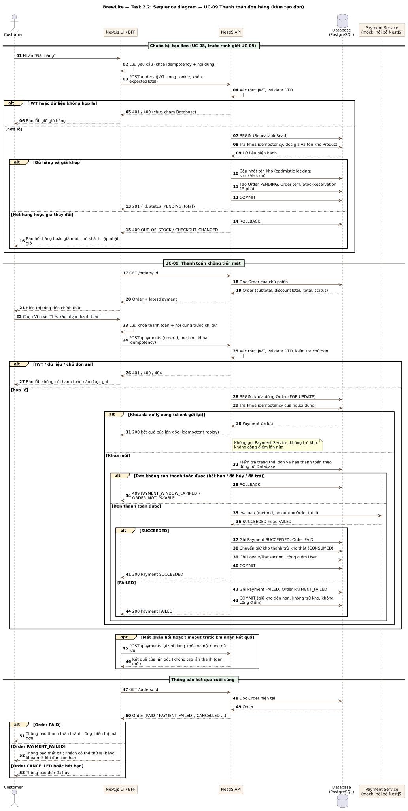

# Task 2.2 — Sequence diagram: UC-09 Thanh toán đơn hàng

| Thông tin | Giá trị |
|---|---|
| Nguồn / hình | [sequence-checkout.puml](sequence-checkout.puml) · [sequence-checkout.svg](sequence-checkout.svg) |
| Use case | UC-09 theo [Task 1.3](../requirements/use-case-checkout.md); UC-08 tạo đơn là bước chuẩn bị |
| Căn cứ | [SRS](../requirements/srs.md), [contract](../assignment2/CONTRACTS.md), [contract checkout tham khảo](../reference/a1/checkout-contract.md) |
| Trạng thái | Bản vẽ lại theo đề Task 2.2; chờ reviewer (D) duyệt, chưa nghiệm thu |

## Đối chiếu yêu cầu Task 2.2

| Yêu cầu của đề | Có trong hình |
|---|---|
| Lifeline Customer → Next.js UI → NestJS API → Database → Payment Service | Đủ năm lifeline; Payment Service là mock nội bộ NestJS |
| Request/response và thứ tự gọi API | `POST /orders`, `GET /orders/:id`, `POST /payments`, `GET /orders/:id` |
| Kiểm tra JWT và validate dữ liệu | Có kiểm tra JWT và validate DTO trước khi xử lý tạo đơn/thanh toán; nhánh lỗi 401/400/404 |
| Transaction khi tạo đơn và cập nhật tồn kho | BEGIN, optimistic locking `stockVersion`, tạo Order + giữ kho, COMMIT hoặc ROLLBACK |
| Nhánh alt thanh toán thành công/thất bại | SUCCEEDED (PAID, trừ kho, cộng điểm) và FAILED (PAYMENT_FAILED, giữ kho đến hạn), cùng một transaction |
| Idempotency khi client gửi lại | Nhánh opt mất phản hồi: khách chủ động gửi lại đúng owner/khóa/nội dung. Nếu request trước chưa tới server hoặc đã rollback thì xử lý như lần đầu; nếu đã commit thì replay attempt đã lưu, không gọi Payment Service, không lặp kho/điểm |
| Idempotency khi tạo đơn | Tra khóa trước khi kiểm giá/kho: khóa đã có và nội dung khớp thì replay đơn cũ (C-A07), không tính lại giá, không giữ kho, không tạo đơn lần nữa; khóa đã có nhưng nội dung khác trả 409 và dừng; khóa mới mới chạy kiểm giá/kho và tạo đơn (AC-FR-08-1/2) |
| Ranh giới UC-08/UC-09 | Khung tạo đơn chỉ chạy khi chưa có Order; đã có Order thì dùng lại orderId. Nhánh lỗi tạo đơn dừng luồng bằng `break`, không sang GET/payment |
| Retry sau FAILED | Ghi chú: PAYMENT_FAILED → PENDING → kết quả cuối trong cùng transaction, không commit PENDING trung gian |
| Thông báo kết quả cuối cùng | Đọc lại Order rồi thông báo thành công, thất bại hoặc đã hủy |

BFF đọc cookie phiên và gửi sang NestJS dưới dạng `Authorization: Bearer`. Thanh toán thất bại là kết quả nghiệp vụ trả HTTP 200, không phải lỗi transport. Đơn legacy thiếu policy/reservation bị từ chối `LEGACY_ORDER_REQUIRES_REVIEW`. Khóa dòng Order trước khi kiểm tra hạn thanh toán theo đồng hồ Database.

## Giới hạn

Hình là thiết kế để review, không chứng minh code đã chạy hay AC đã đạt. Hủy đơn và hết hạn tự động không có sequence riêng; chúng được mô tả ở [ngữ cảnh hỗ trợ](../requirements/checkout-supporting-flows.md) (C-A08, C-X01).
